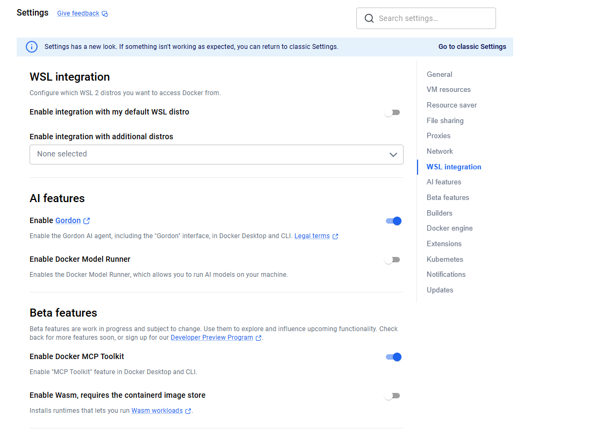

# Setup

Installs everything this project needs, in order. Run the files in `setup/`
numbered `1` through `4`. Each one checks whether its own job is already done
before doing anything, so re-running any of them is safe.

| # | File | What it does |
|---|---|---|
| 1 | `1-check-environment.sh` + `.cmd` | Read-only. Reports what is missing and what to run next. Changes nothing. |
| 2 | `2-install-wsl.cmd` | Installs WSL 2 + Ubuntu-24.04, if missing. **Windows only** — WSL is a Windows concept, there is nothing to install on macOS/Linux. |
| 3 | `3-install-docker-desktop.cmd` | Installs Docker Desktop, if missing; makes sure it is running and reachable from Ubuntu-24.04. **Windows only** — on macOS, install Docker Desktop yourself (`brew install --cask docker`). |
| 4 | `4-install-nemoclaw.sh` + `.cmd` | Installs NemoClaw (which installs OpenShell and its gateway as part of its own install). Runs on macOS, Linux, and Windows (via WSL). |
| 4b | `4b-install-openshell-versions.sh` + `.cmd` | Optional. Downloads specific OpenShell releases (default: `0.0.116` and `0.1.9`; or any you list, e.g. `install 0.1.5`) into `~/.local/share/openshell-lab/`, verified against the published SHA-256 lists. Downloading does not change the active version; `use VERSION` does, and `run-enforcement-audit` switches versions itself. Linux/WSL only. |
| 5 | `5-uninstall-everything.sh` + `.cmd` | **Deletes things.** Menu by number (`0` = items 1-5): sandboxes/containers, gateway service, commands, `~/.nemoclaw`, nvm; and, Windows only, Docker Desktop (6) and the Ubuntu distro (7). Items 6 and 7 are never part of `0` and each needs its own typed confirmation. Add `dry` (`.cmd`) or `DRY_RUN=1` (`.sh`) to preview. |


The paired setup `.cmd` files for steps 1, 4, and 5 forward into WSL and run
the matching `.sh` logic. Steps 2 and 3 are native Windows scripts with no
`.sh` counterpart because installing WSL, or installing Docker Desktop via
`winget`, has no Linux/macOS equivalent.

## Why step 4 sets `NEMOCLAW_AGENT=hermes`

Step 4 installs without onboarding (no sandbox, no model provider, no API key).
NemoClaw's installer only allows that for agents that declare
`deferred_onboarding: true` (`hermes`, `langchain-deepagents-code`), not for
the default `openclaw`. No agent is actually onboarded, so the installed tools
(`nemoclaw`, `openshell`, the gateway) are identical either way, and you can
choose any agent later with `nemoclaw onboard --agent <name>`. The installer's
closing "NemoHermes CLI is installed" message is a side effect of this.

## Notes for a fresh Windows machine

- Steps 2 and 3 install Windows features and Docker Desktop: expect a UAC
  prompt (or run them from an administrator terminal) and possibly a restart.
- Every `.cmd` file targets `Ubuntu-24.04` explicitly (`wsl -d`), so another
  default distro does not confuse the checks. Step 3 does make `Ubuntu-24.04`
  the default distro, because Docker Desktop's WSL integration follows it.
- Step 4 refuses to run NemoClaw's installer unless the pinned tag still
  points at the commit recorded in `4-install-nemoclaw.sh`.
- On Linux without apt-get, git and curl are installed with dnf, pacman or
  zypper; any other package manager needs them installed by hand. macOS needs
  Homebrew and a running Docker Desktop.

## Start here

```
setup\1-check-environment.cmd
```

It tells you exactly which numbered file to run next for anything that is
missing. Keep running it after each step until everything passes, then run
`setup\4-install-nemoclaw.cmd`.

After setup passes, return to the project root and run:

```text
run-enforcement-audit.cmd
```

The menu lets the user choose network tests, filesystem tests, or both. For unattended execution, pass exactly one of `--all`, `--network-only`, or `--filesystem-only` after `nopause`.

## Known issue: Docker Desktop installed, but step 3 or 4 still can't reach it

This happened on a real test of this project's own setup, and is worth
knowing about before it wastes your time.

**Symptom:** `3-install-docker-desktop.cmd` sits at `[3/4] Making sure Docker
Desktop is running` for several minutes and then fails with
`Docker did not become ready`, even though Docker Desktop's own window shows
"Engine running".

**Cause:** Docker Desktop has a separate on/off switch for whether it
connects to WSL distros at all. On a fresh install, it can be **off by
default** — so Docker's engine can be perfectly healthy on the Windows side
while being completely unreachable from inside Ubuntu-24.04.

**Fix:** open Docker Desktop itself (not this script) →
**Settings → Resources → WSL integration**:



If **"Enable integration with my default WSL distro"** is switched off (as
in the screenshot above), turn it on — Ubuntu-24.04 is already the default
distro, which `3-install-docker-desktop.cmd` sets up for you. Alternatively,
open the **"Enable integration with additional distros"** dropdown and select
`Ubuntu-24.04` there explicitly. Either one is enough on its own.

Click **Apply & Restart**, wait for Docker Desktop to come back up, then run
`setup\3-install-docker-desktop.cmd` again. It should now finish within a few
seconds.

This is a one-time, per-install setting: once it is on, it stays on across
reboots and restarts, and this step will not come up again unless Docker
Desktop is reinstalled from scratch.

### Why quitting and reopening Docker Desktop did not fix it on its own

Before finding the toggle above, we tried the more common fix for WSL
integration problems: fully quitting Docker Desktop (not just closing its
window) and reopening it, so it re-reads which WSL distro is the default one.
On a normal Docker Desktop install, that is often enough by itself.

On this test, it was not: the underlying switch above was off, and quitting
and reopening Docker Desktop does not turn it on. If you hit this problem on
your own machine, try quitting and reopening Docker Desktop first since it
is quick and sometimes is the whole fix — but if `3-install-docker-desktop.cmd`
still fails afterward, check the toggle above directly rather than trying
more restarts.

### Also normal: the very first start takes longer than usual

Right after Docker Desktop is first installed, its very first startup sets
up its backend from scratch and can take several minutes — longer than any
start after that. `3-install-docker-desktop.cmd` allows up to 6 minutes for
this and prints a line every 10 seconds so a long wait does not look frozen;
seeing those lines for a few minutes on a brand-new install is expected, not
a sign of a problem.
